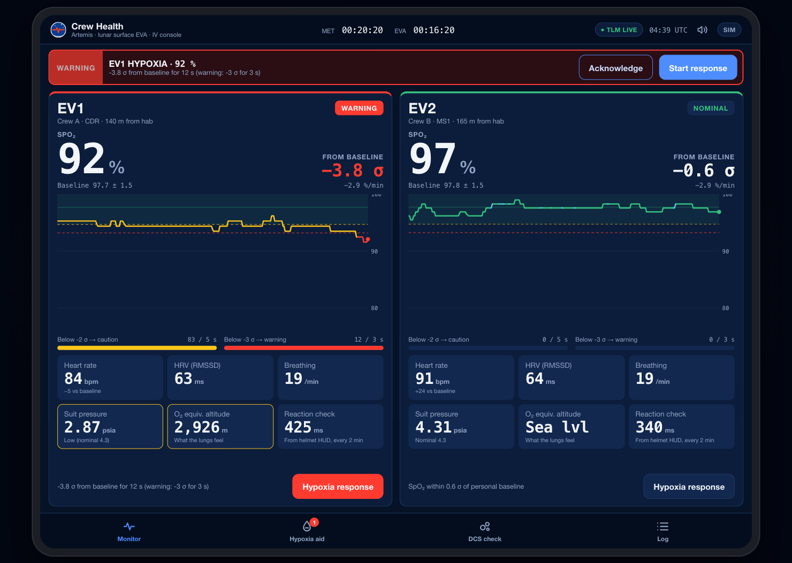

# Crew Health: EVA hypoxia monitor (NASA Space Apps 2026)

A tablet console for the crewmember inside a lunar habitat. It watches both spacewalkers' vitals in real time, raises a caution or warning (tone + voice) when either one's SpO₂ drifts below their personal baseline for too long, and walks the crewmate through hypoxia first aid and a DCS check with multiple-choice steps. It is deterministic: no LLMs.



## Run

```bash
./apps/tablet/run.sh      # then open http://localhost:8000
```

Needs Python 3.11+ and Node 18+. Full details: [`tablet/README.md`](../apps/tablet/README.md).

## What's here

| Folder | Contents |
|---|---|
| [`tablet/`](../apps/tablet) | FastAPI backend (data replay, deviation-duration detector, NASA DCS treatment model) and React + TypeScript iPad app (13" iPad Pro, 1376 × 1032 pt) |
| [`HYPOXIA/`](../research/HYPOXIA) | Data pack: NASA crew physiology, EVA log and incidents, hypoxia evidence report facts and risk graph, plus the analog Harespod SpO₂ dataset. See [`HYPOXIA/README.md`](../research/HYPOXIA/README.md) for sources and links. |

Two raw files (256 Hz ECG, 100 Hz PPG waveforms) exceed GitHub's 100 MB limit and are not in the repo. The app doesn't need them; `research/HYPOXIA/scripts/build_hypoxia_dataset.py` rebuilds them from the original downloads.

## NASA data used

- Flight Crew Physiological Data for Crew State Monitoring: https://data.nasa.gov/dataset/flight-crew-physiological-data-for-crew-state-monitoring
- Extra-vehicular Activity (EVA) – US and Russia: https://data.nasa.gov/dataset/extra-vehicular-activity-eva-us-and-russia
- Risk of Hypobaric Hypoxia from the Exploration Atmosphere (NTRS 20150021491): https://ntrs.nasa.gov/citations/20150021491
- Hypobaric Decompression Sickness Treatment Model (NASA TP-2014-218561)

*Concept prototype. Not for medical use.*
